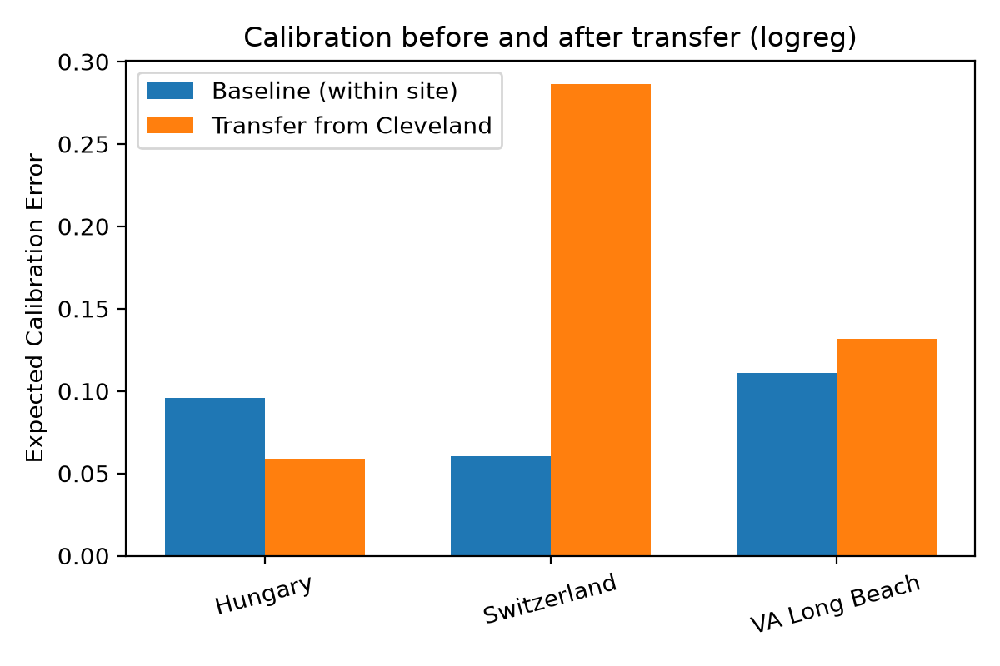
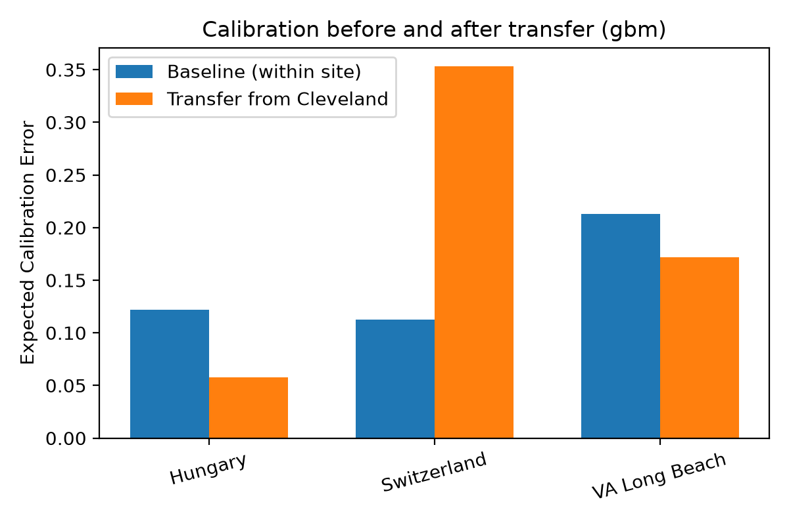
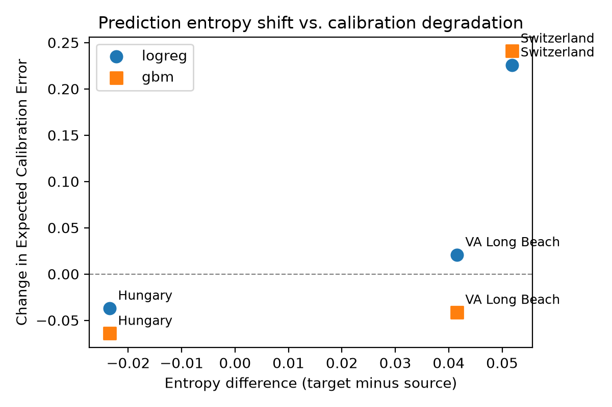
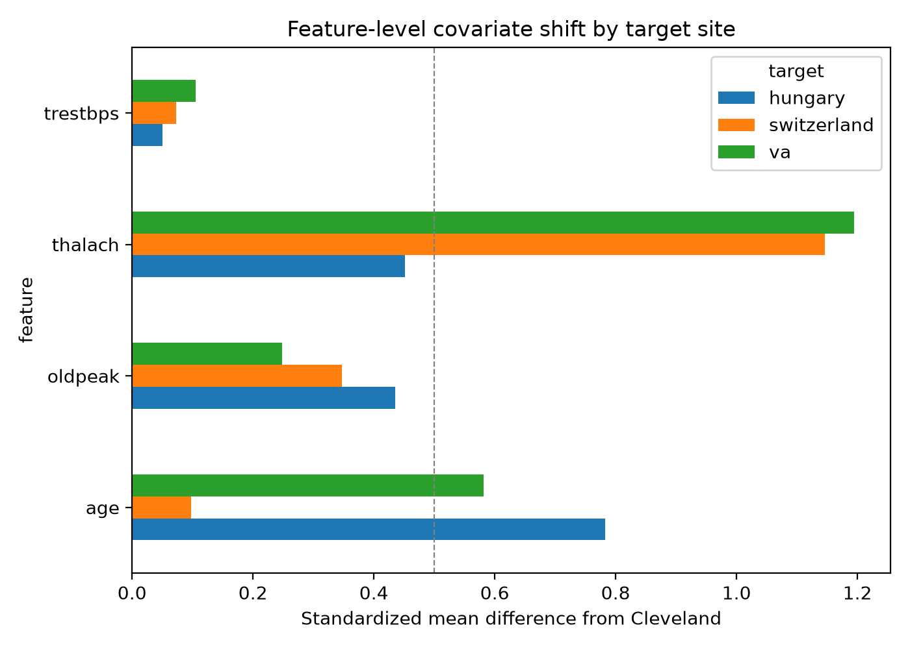

# ClinShift

Robustness and calibration of clinical prediction models under
cross-site distribution shift.

## Overview

Clinical prediction models are typically developed at one institution
and evaluated at another. The evaluation usually reports discrimination
through AUROC, while calibration receives less attention. This project
studies the two properties separately on a publicly available
multi-site clinical dataset and asks whether the degradation of
calibration under transfer can be anticipated before outcome labels
become available at the target site.

## Data

The UCI Heart Disease dataset, containing records from Cleveland,
Hungary, Switzerland, and the VA Long Beach Medical Center. The dataset
is downloaded from the UCI machine learning repository at runtime. No
local copy is committed to the repository.

Preprocessing decisions, including the exclusion of cholesterol from
the shared feature set, are documented in `docs/decisions.md`.

## Repository structure

ClinShift/
├── .github/workflows/    CI and experiment runs
├── docs/                 Design decisions
├── experiments/          Reproducible experiment scripts
├── scripts/              Utilities and figure generation
├── src/                  Core implementation
├── tests/                Unit tests
├── results/              Metrics, figures, and result documentation
└── requirements.txt

Each subdirectory under `results/` contains a README that describes the
files it holds.

## Running the pipeline

Each experiment is a standalone module under `experiments/`. The
GitHub Actions workflow runs the sequence on every push to `main` and
commits the resulting files back to `results/`.

python -m experiments.run_baseline
python -m experiments.run_transfer
python -m experiments.run_shift_analysis
python -m experiments.run_concept_shift
python -m experiments.run_detection_analysis
python -m scripts.make_figures

## Main findings

**Discrimination and calibration decouple under transfer.**

A logistic regression model trained on Cleveland and evaluated on
Switzerland improves its AUROC from 0.73 to 0.77 relative to a model
trained on Switzerland itself. Over the same transfer, its Expected
Calibration Error rises from 0.06 to 0.29. The two metrics move in
opposite directions. The same pattern appears with the gradient
boosting model, where AUROC rises from 0.66 to 0.69 while ECE rises
from 0.11 to 0.35. An evaluation that reports only discrimination
would not detect the calibration failure.

**Unlabeled prediction-based indicators track calibration
degradation.**

Six unlabeled shift indicators were compared to the change in ECE
across the three target sites. Feature-based indicators, which compare
the marginal distributions of features, and Jensen-Shannon divergence
of predicted probabilities reached a Spearman correlation near 0.5
with the change in ECE. Two prediction-based indicators, the
difference in mean predicted probability and the difference in mean
predictive entropy, reached a Spearman correlation of 1.0 for both
models.

With three target sites, a perfect rank correlation has a
non-negligible probability of arising by chance. The result is
therefore presented as descriptive rather than inferential, and
replication on datasets with more sites would be required before these
indicators could be used as a deployment-time check.

**Concept divergence accompanies calibration degradation.**

Coefficient vectors of logistic regression models fitted
independently at each site on a shared feature space have pairwise
Euclidean distances between 1.78 and 2.47. The mean absolute
difference between the predictions of these models on the Cleveland
evaluation set ranges from 0.11 to 0.37. The two measures agree on
which pairs of sites are most divergent.

| Pair                     | Coefficient distance | Prediction divergence |
|--------------------------|----------------------|-----------------------|
| Cleveland – Hungary      | 2.385                | 0.113                 |
| Cleveland – Switzerland  | 2.465                | 0.368                 |
| Cleveland – VA           | 1.972                | 0.159                 |
| Hungary – Switzerland    | 2.343                | 0.372                 |
| Hungary – VA             | 1.780                | 0.140                 |
| Switzerland – VA         | 2.248                | 0.305                 |

Switzerland appears in all three of the largest pairwise distances in
both measures. The sign of the coefficient for sex reverses at
Switzerland relative to the other three sites. This reversal is
consistent with the site's positive rate of 93.5%, which changes the
interpretation of sex as a predictor in the sample.

For the three pairs of the form (Cleveland, target), prediction
divergence aligns with the change in ECE observed in the transfer
experiments: Hungary has the smallest divergence and the smallest
change in calibration, Switzerland has the largest of both, and VA
falls in between. These measures are descriptive and do not isolate
concept shift from other sources of variation.

**Site-level data quality affects the interpretation of transfer.**

All 123 cholesterol measurements at the Switzerland site are recorded
as zero. These entries are stored as valid numerical values rather
than missing entries, so a standard missing-data pipeline does not
detect them. When cholesterol is included in the shared feature set,
the standardized mean difference between Cleveland and Switzerland
reaches 6.74 and the Kolmogorov-Smirnov statistic reaches 1.0, which
indicates no overlap between the two distributions.

The effect of this decision on the transfer results is reported in
`results/ablation_chol.json`, which places the current run side by
side with the earlier run that included cholesterol. In the transfer
from Cleveland to Switzerland, excluding cholesterol changes the
Expected Calibration Error of the logistic regression model from 0.42
to 0.29, and of the gradient boosting model from 0.41 to 0.35. The
change is larger than 0.1 in both cases. Discrimination is affected
only slightly.

The concentration of zero values raises a data quality concern, and
analyses that retain the feature may conflate differences in recorded
measurements with differences between patient populations. The current
analysis does not establish which of these two contributions
dominates.

The largest remaining covariate shift between sites is in maximum
heart rate, which appears in all three transfer targets.

## Results summary

Within-site cross-validation with logistic regression:

| Site        | AUROC | ECE   |
|-------------|-------|-------|
| Cleveland   | 0.880 | 0.105 |
| Hungary     | 0.901 | 0.096 |
| Switzerland | 0.726 | 0.061 |
| VA          | 0.700 | 0.111 |

Cross-site transfer from Cleveland, raw predictions:

| Target      | AUROC | ECE   | Δ AUROC | Δ ECE |
|-------------|-------|-------|---------|-------|
| Hungary     | 0.881 | 0.059 | −0.021  | −0.037 |
| Switzerland | 0.771 | 0.286 | +0.045  | +0.226 |
| VA          | 0.725 | 0.132 | +0.025  | +0.021 |

Transfer from Cleveland does not uniformly reduce discrimination. In
Switzerland and VA, the transferred model achieves higher AUROC than a
model trained on the target site alone. This pattern may reflect
differences in patient populations, data collection practices, or
measurement conventions across sites. The current analysis does not
distinguish among these explanations.

## Unlabeled shift indicators

| Indicator               | Hungary | Switzerland | VA    |
|-------------------------|---------|-------------|-------|
| Density ratio AUROC     | 0.977   | 0.980       | 0.957 |
| MMD (RBF kernel)        | 0.128   | 0.151       | 0.157 |
| Energy distance         | 1.133   | 1.421       | 1.445 |
| Jensen-Shannon (pred)   | 0.050   | 0.142       | 0.150 |
| Confidence shift        | −0.069  | +0.205      | +0.195 |
| Entropy difference      | −0.024  | +0.052      | +0.042 |

Spearman correlation with change in ECE:

| Indicator               | Logistic regression | Gradient boosting |
|-------------------------|---------------------|-------------------|
| Density ratio AUROC     | 0.500               | 0.500             |
| MMD (RBF kernel)        | 0.500               | 0.500             |
| Energy distance         | 0.500               | 0.500             |
| Jensen-Shannon (pred)   | 0.500               | 0.500             |
| Confidence shift        | 1.000               | 1.000             |
| Entropy difference      | 1.000               | 1.000             |

## Limitations

The dataset contains four sites, of which three are used as transfer
targets. Correlation estimates over three points are exploratory and
should not be used for inference.

The Switzerland and VA sites differ from Cleveland and Hungary in
positive rate and in the amount of missing data. Part of the observed
transfer effect may reflect intrinsic site difficulty rather than
distribution shift between populations. The current analysis does not
separate these two contributions.

The distinction between covariate shift, concept shift, and data
quality artifacts is treated descriptively. None is identified
causally.

Post-hoc calibration is fitted on source data. Its behavior under
target shift is one of the phenomena under study rather than a solved
problem. Isotonic calibration was observed to reduce AUROC on some
target sites for the gradient boosting model, while Platt scaling
never altered AUROC.

The source probabilities used in the prediction-based indicators are
out-of-fold predictions on Cleveland, while the target probabilities
come from a single model fitted on the full Cleveland site. The two
sets therefore come from slightly different models, and this
discrepancy is expected to be small relative to the site-level
differences the indicators are designed to measure.

## Reproducibility

Random seeds are fixed and passed explicitly to every stochastic
component. The GitHub Actions workflow runs the full pipeline on each
push to `main` and commits the resulting JSON and CSV files to
`results/`. Figures are regenerated from these files alone and do not
require access to the raw dataset.

## License

MIT
